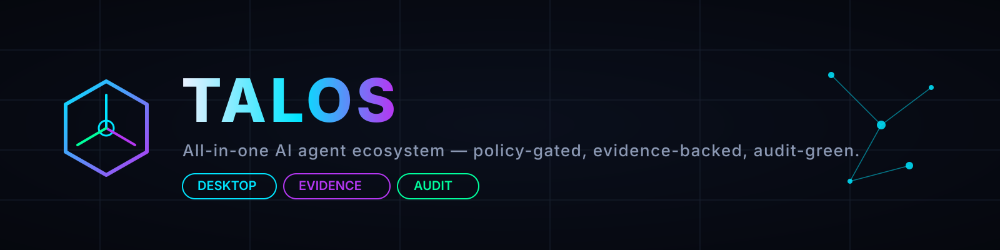
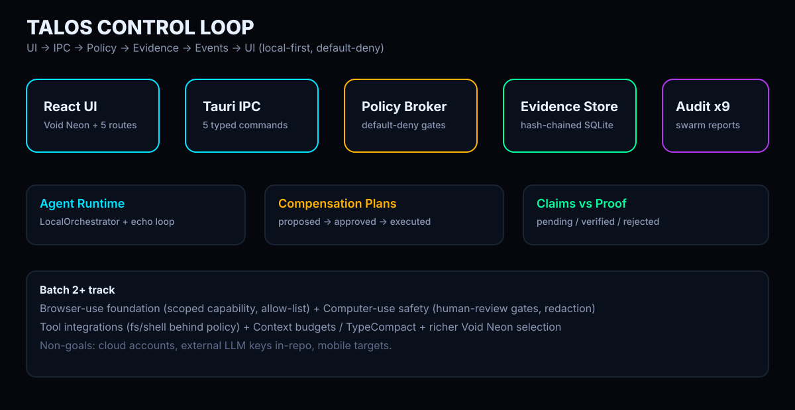

<div align="center">



# Talos

**The open-source all-in-one AI agent ecosystem: coding, browser-use, computer-use, orchestration, evidence, and audit in one AAA-grade desktop command center.**

[](https://github.com/shubhanand021-EXA/talos/actions/workflows/ci.yml)
[](LICENSE)
[](https://github.com/shubhanand021-EXA/talos/tags)
[](crates/Cargo.toml)
[](.nvmrc)
[](package.json)

> **Note:** this repository is currently private. Badges and links resolve for collaborators with access; CI status is authoritative in the Actions tab.


_Void-black command center — neon pulse, agent network motion, policy-gated control loop._

[Quickstart](#quickstart) · [Architecture](#architecture) · [Capability Matrix](#target-capability-matrix) · [Roadmap](#roadmap) · [Security](SECURITY.md) · [Contributing](CONTRIBUTING.md) · [Changelog](CHANGELOG.md)

</div>

---

## Why Talos

Fragmented agent tooling forces you to stitch together coding assistants, browser bots, computer-use hacks, orchestrators, and audit spreadsheets — with no shared policy, no shared evidence, and no shared desktop.

Talos is one monorepo, one contract layer, one policy broker, one evidence ledger, and one desktop shell:

- 🧩 **All-in-one agent ecosystem** — coding, browser-use foundation, computer-use safety layer, orchestration, evidence, and audit in a single workspace.
- 🛡️ **Policy-gated actions** — default-deny engine (`crates/policy_broker`); writes need evidence, irreversible actions need compensation plans.
- 🔗 **Evidence ledger** — hash-chained SQLite log (`crates/evidence_store`); claims move `pending → verified / rejected / conflicting` only through guarded transitions.
- 🧯 **Compensation plans** — `proposed → approved → executed / failed`, with `executed → rolled_back`; tamper detection tested.
- 🌐 **Browser-use foundation** — 8 policy-gated actions (`browser.navigate/click/type/scroll/select/extract/screenshot/snapshot`) with isolated per-task profiles, DOM-first safety (selector resolution + visibility checks), dry-run-first mutations, and ledgered receipts (`packages/browser-use` + `crates/tool_runtime`, Browser page at `/browser`). Mock by default; live Chromium is an explicit local opt-in.
- 🖥️ **Computer-use safety layer** — 9 policy-gated actions (`computer.move_mouse/click/double_click/drag/type_text/hotkey/scroll/capture_screen/locate_element`) on a virtual screen with a mandatory safety envelope: global enable flag off by default, dry-run default, 30/min rate limit, viewport bounds, confidence floor, dangerous-zone blocking (settings, password managers), warnings for terminals and payment flows, and an emergency stop that cancels tasks and blocks everything until explicitly reset. Mock-only; real OS control is not implemented (`crates/computer_use`, Computer page at `/computer`).
- 🌌 **Void Neon 3D command center** — dark void, neon graph, spatial topology of agents/tools/memory (`apps/ui` + R3F).
- 🧰 **Tool framework** — registered, schema-validated, policy-gated, evidence-backed tools (`crates/tool_runtime`): `fs.read/list/search`, `fs.write` (backup + compensation), `process.exec` (disabled by default, allowlisted). Dry-run first, receipts always ledgered. Manage in Tools page (`/tools`).
- 🕵️ **9-agent audit swarm** — security, privacy, reliability, performance, architecture, evidence, dependencies, UI/UX, product (`tools/audit`).

> Current phase: **Batch 2 computer-use safety layer**. Queue + tools + browser mock + computer mock live locally; no real OS control exists anywhere in the tree. See [docs/adr/0001-browser-use-architecture.md](docs/adr/0001-browser-use-architecture.md) and [docs/adr/0002-computer-use-safety-layer.md](docs/adr/0002-computer-use-safety-layer.md).

---

## Quickstart

Requires: `git >= 2.40`, Node.js LTS (see [.nvmrc](.nvmrc), currently v26), `pnpm >= 10` (pinned via `packageManager`), Rust stable + `cargo`, [just](https://github.com/casey/just) `>= 1.30`.

```sh
git clone https://github.com/shubhanand021-EXA/talos.git
cd talos
pnpm install        # or: just setup
pnpm typecheck      # strict tsc --noEmit
pnpm lint           # prettier + workspace lints
pnpm test           # root smoke + workspace suites
pnpm build          # workspace builds
pnpm audit:swarm    # 9-agent audit swarm
pnpm media:generate # regenerate docs/media brand assets
```

Run it:

```sh
pnpm dev:ui       # browser-only UI (mock snapshot, disconnected banner)
pnpm dev:desktop  # Tauri window + live local loop (needs display + WebView2)
```

Validate Rust:

```sh
cd crates && cargo fmt --all -- --check
cargo clippy --workspace --all-targets -- -D warnings
cargo test --workspace
```

Full command matrix and headless caveats: [docs/RUNBOOK.md](docs/RUNBOOK.md) · CI behavior: [docs/CI.md](docs/CI.md).

---

## Architecture



**Pentagon: Foundation · Brain · Soul · Face · Shield.**

```text
talos/
  apps/
    desktop/      # Tauri 2 shell (com.talos.desktop), 5 typed IPC commands
    ui/           # React 19 + Vite + Tailwind + Zustand + Void Neon viewport
  crates/
    talos_common/   # typed IDs, error model, time/serde/tracing helpers
    policy_broker/  # default-deny engine + context hooks + --selftest
    evidence_store/ # SQLite + hash-chained event_log, claims, compensation
    agent_runtime/  # LocalOrchestrator: diagnostic loop + durable task queue (lifecycle, worker, supervisor)
  packages/
    contracts/    # @talos/contracts — Zod schemas, single source of truth
  tools/
    audit/        # @talos/audit-swarm — 9 agents, Markdown + JSON reports
  docs/
    ARCHITECTURE.md PROGRESS.md EVIDENCE.md ROADMAP.md CI.md RUNBOOK.md
    media/        # logo, banner, hero.gif, evidence.gif, architecture.svg
    reports/      # audit-latest.{md,json} + dated copies
  scripts/
    media/        # generate-brand.mjs — deterministic, dependency-free
  .github/
    workflows/ci.yml + README + CODEOWNERS + ISSUE_TEMPLATE + PR template
```

Local control loop: **UI → IPC → Policy → Evidence → Events → UI**.

- `run_diagnostic` executes a 3-action echo loop (read Allow, write → evidence → Allow, irreversible → plan → Allow).
- `submit_task` enqueues durable work (SQLite: queue, attempts, transitions, cancellations); the worker executes through the policy broker with priority order, per-attempt timeouts, retryable backoff, and cooperative cancellation. `cancel_task` / `retry_task` / `list_tasks` / `get_task_state` are live in the Agents page and Dashboard queue table.
- Every side effect passes `PolicyContext` gates — no bypass paths.
- Evidence page verifies the chain live (`verify_evidence_ledger`); broken fixtures render `CHAIN BROKEN` with `first bad seq`.


_Ledger verification — hash-chain validation, claim lifecycle, policy allow/deny states._

Deep dive: [docs/ARCHITECTURE.md](docs/ARCHITECTURE.md) · [docs/EVIDENCE.md](docs/EVIDENCE.md) · [docs/PROGRESS.md](docs/PROGRESS.md).

---

## Target Capability Matrix

> **Target Capability Matrix** — design intent for the completed Talos track, not a claim about third-party products. Fragmented columns describe typical single-purpose tool categories; Talos aims to unify them under one policy + evidence + audit roof.

| Capability                         | Typical coding agents | Typical browser agents | Typical computer-use agents | Typical orchestration tools | Typical audit systems | **Talos target**                                            |
| ---------------------------------- | --------------------- | ---------------------- | --------------------------- | --------------------------- | --------------------- | ----------------------------------------------------------- |
| Coding + repo tools                | ✅                    | ❌                     | ❌                          | ⚠️                          | ❌                    | ✅ policy-gated fs/shell (read first, writes with evidence) |
| Browser-use (scoped, allow-listed) | ❌                    | ✅                     | ⚠️                          | ❌                          | ❌                    | ✅ navigation observation + action allow-list               |
| Computer-use (human-review gates)  | ❌                    | ❌                     | ✅                          | ❌                          | ❌                    | ✅ UI-action capability + redaction + approval              |
| Orchestration (multi-agent, queue) | ⚠️                    | ❌                     | ❌                          | ✅                          | ❌                    | ✅ task queue, lifecycle, cancellation/timeouts             |
| Policy broker (default-deny)       | ❌                    | ❌                     | ❌                          | ❌                          | ❌                    | ✅ central authority, context hooks, no bypass              |
| Evidence ledger (claims vs proof)  | ❌                    | ❌                     | ❌                          | ❌                          | ⚠️                    | ✅ hash-chained log, guarded transitions, tamper tests      |
| Compensation / rollback plans      | ❌                    | ❌                     | ❌                          | ⚠️                          | ❌                    | ✅ proposed → approved → executed → rolled_back             |
| Desktop command center (Void Neon) | ❌                    | ❌                     | ❌                          | ❌                          | ❌                    | ✅ Tauri 2 + React + 3D topology, offline-first             |
| 9-agent audit swarm                | ❌                    | ❌                     | ❌                          | ❌                          | ⚠️                    | ✅ 9 agents, thresholds, Markdown + JSON, CI-gated          |

Legend: ✅ native target · ⚠️ partial in typical tools · ❌ generally absent. No third-party product is named or evaluated here.

---

## Roadmap

- [x] **Batch 1 — Green Baseline (v0.1.0)**: monorepo, contracts, policy broker, evidence ledger, React shell, Void Neon baseline, Tauri shell, local loop, audit swarm, CI.
- [x] **Batch 2 — Durable runtime**: SQLite-backed task queue (entries, attempts, transitions, cancellations), strict 10-state lifecycle, priority scheduling, timeouts, retry policy, cooperative cancellation, supervisor, seeded MockEchoAgent scenarios, 5 new IPC commands, live queue UI with cancel/retry + task-filtered feed.
- [x] **Batch 2 — Tool framework**: `crates/tool_runtime` (model, registry, adapters, 5 built-ins, policy-gated executor with evidence + compensation), 4 new IPC commands (`list/describe/dry-run/invoke`), Tools page (`/tools`) with catalog + dry-run form + receipt viewer, 15 runtime + 6 desktop tool tests.
- [x] **Batch 2 — Browser-use foundation**: 8 policy-gated browser tools + `packages/browser-use` (isolated sessions, mock adapter, opt-in live Chromium, worker CLI), Browser page (`/browser`) with action builder + dry-run + receipt/hash viewer, ADR `docs/adr/0001-browser-use-architecture.md`.
- [x] **Batch 2 — Computer-use safety layer (this prompt)**: `crates/computer_use` (safety envelope, mock virtual screen, disabled real-adapter stub), 9 policy-gated `computer.*` tools, UiAction policy rules (Low allow / Medium evidence-gated / High human review), emergency stop + cancel + reset IPC, Computer page (`/computer`) with safety panel, mock screen, receipt viewer, and status-bar indicator, ADR `docs/adr/0002-computer-use-safety-layer.md`.
- [ ] **Batch 3+ — Brain/Soul/Face**: Tool-RAG + budgeting + TypeCompact, file-backed encrypted ledger, real verifiers, richer Void Neon interactions, expanded audit metrics.

Details: [docs/ROADMAP.md](docs/ROADMAP.md) · history: [CHANGELOG.md](CHANGELOG.md).

---

## Security

Local-first threat model. Policy broker is the only authority; Tauri runs least-privilege (zero fs/shell/HTTP/dialog permissions); ledger is append-only with tamper tests; audit swarm scans for secrets on every run.

- Do **not** report vulnerabilities in public issues.
- See [SECURITY.md](SECURITY.md): `security@talos.dev` placeholder + GitHub private vulnerability reporting when enabled.
- Operational notes: [docs/RUNBOOK.md](docs/RUNBOOK.md).

---

## Contributing

Single source of truth (`@talos/contracts`), policy-central side effects, evidence-first claims, audit-green pushes.

- Dev setup, branch model (`main` + short-lived `feat|fix|chore|docs/` branches), Conventional Commits, testing + audit gates, PR checklist: [CONTRIBUTING.md](CONTRIBUTING.md).
- Issue forms: [`.github/ISSUE_TEMPLATE`](.github/ISSUE_TEMPLATE) · PR template: [`.github/PULL_REQUEST_TEMPLATE.md`](.github/PULL_REQUEST_TEMPLATE.md).
- Owners: [`.github/CODEOWNERS`](.github/CODEOWNERS).

```sh
pnpm install
pnpm typecheck && pnpm lint && pnpm test && pnpm build
pnpm audit && pnpm audit:swarm
```

---

## License

MIT — see [LICENSE](LICENSE). Workspace crates declare `license = "MIT"`; UI/contracts/desktop packages are `private: true` (not published).

---

## Acknowledgements

Led by **Shubh Anand**.

Original brand system generated offline via `scripts/media/generate-brand.mjs` — no external assets, no copyrighted inputs. Tauri icons in `apps/desktop/src-tauri/icons/` remain generated placeholders; see [docs/media/README.md](docs/media/README.md) for the replacement step.
