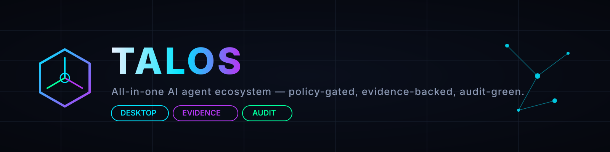
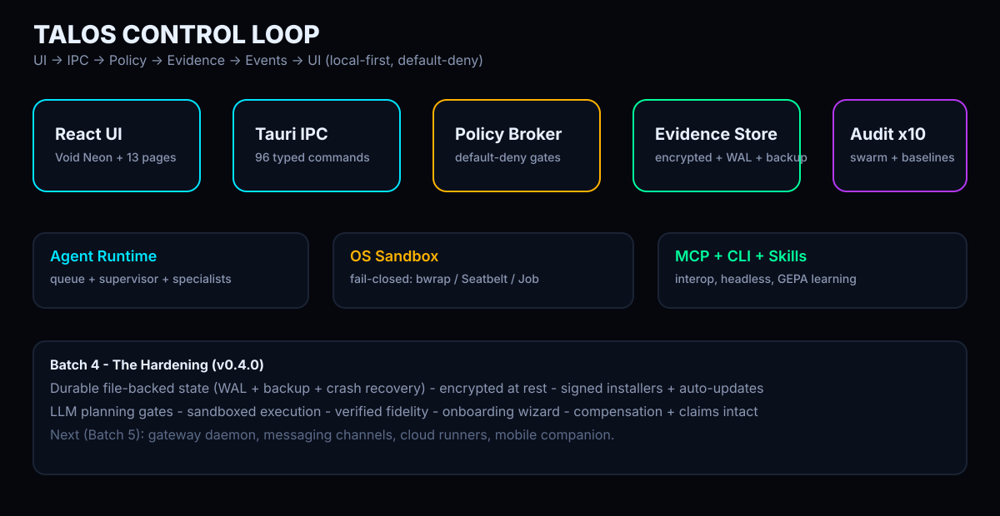

<div align="center">



# Talos

**The open-source all-in-one AI agent ecosystem: coding, browser-use, computer-use, orchestration, evidence, and audit in one AAA-grade desktop command center.**

[](https://github.com/shubhanand021-EXA/talos/actions/workflows/ci.yml)
[](LICENSE)
[](https://github.com/shubhanand021-EXA/talos/releases)
[](https://github.com/shubhanand021-EXA/talos/stargazers)
[](https://github.com/shubhanand021-EXA/talos/network/members)
[](crates/Cargo.toml)
[](.nvmrc)
[](package.json)

> **Talos is public and open-source (Apache-2.0).** Badges above are live; CI status is authoritative in the [Actions tab](https://github.com/shubhanand021-EXA/talos/actions).


_Void-black command center — neon pulse, agent network motion, policy-gated control loop._

[Quickstart](#quickstart) · [Architecture](#architecture) · [Capability Matrix](#target-capability-matrix) · [Roadmap](#roadmap) · [Security](SECURITY.md) · [Contributing](CONTRIBUTING.md) · [Changelog](CHANGELOG.md)

</div>

---

## Why Talos

Fragmented agent tooling forces you to stitch together coding assistants, browser bots, computer-use hacks, orchestrators, and audit spreadsheets — with no shared policy, no shared evidence, and no shared desktop.

Talos is one monorepo, one contract layer, one policy broker, one evidence ledger, and one desktop shell:

- 🧩 **All-in-one agent ecosystem** — coding, browser-use foundation, computer-use safety layer, context budgeting + TypeCompact, local-first Tool-RAG routing, orchestration, evidence, and audit in a single workspace.
- 🛡️ **Policy-gated actions** — default-deny engine (`crates/policy_broker`); writes need evidence, irreversible actions need compensation plans.
- 🔗 **Evidence ledger** — hash-chained SQLite log (`crates/evidence_store`); claims move `pending → verified / rejected / conflicting` only through guarded transitions.
- 🧯 **Compensation plans** — `proposed → approved → executed / failed`, with `executed → rolled_back`; tamper detection tested.
- 🌐 **Browser-use foundation** — 9 policy-gated actions (`browser.navigate/click/type/scroll/select/extract/screenshot/snapshot/session`) with isolated per-task profiles, DOM-first safety (selector resolution + visibility checks), dry-run-first mutations, and ledgered receipts (`packages/browser-use` + `crates/tool_runtime`, Browser page at `/browser`). Mock by default; live Chromium is an explicit local opt-in (`TALOS_BROWSER_LIVE=1`, headless, 30s worker timeout, per-call spawned worker).
- 🖥️ **Computer-use safety layer** — 9 policy-gated actions (`computer.move_mouse/click/double_click/drag/type_text/hotkey/scroll/capture_screen/locate_element`) on a virtual screen with a mandatory safety envelope: global enable flag off by default, dry-run default, 30/min rate limit, viewport bounds, confidence floor, dangerous-zone blocking (settings, password managers), warnings for terminals and payment flows, and an emergency stop that cancels tasks and blocks everything until explicitly reset. Mock by default; the real OS driver (accessibility APIs + vision verification loop) compiles only behind the explicit `real-os-control` cargo feature — never in CI or default builds (`crates/computer_use`, Computer page at `/computer`).
- 🗜️ **Context budgeting + TypeCompact** — seven layered budgets (safety/system/task/session/evidence/tool/scratchpad, 8_000 tokens) with a deterministic local estimator (no external calls). TypeCompact preserves IDs, safety constraints, policy decisions, evidence/compensation refs, and schema type names; drops only reference-free segments on discardable layers; every result carries a `sha256:` proof hash and is invariant-gated before the receipt is ledgered (`crates/context_budget`, Context page at `/context`).
- 🔎 **Local-first Tool-RAG routing** — SQLite-backed index over manifests, receipts, evidence records, task summaries, and compensation metadata (normalized tables, deterministic tokens, no FTS5, no network). Lexical + semantic ranking blends keyword + capability match with receipt-history boosts and failure penalties, filtered by risk ceiling; local embeddings live (`crates/embedding_engine`, `crates/vector_store`), panel on the Tools page. Batch 3 added semantic ranking over local embeddings (`crates/memory_indexer`, Memory page at `/memory`).
- 🌌 **Void Neon 3D command center** — dark void, neon graph, live spatial topology: core + agents + tasks + tools + browser/computer-use + policy gate + evidence ledger + audit sentinel (`apps/ui` + R3F). Click to inspect, filter by family, focus a selection, replay recent events, watch policy/evidence pulses and the red emergency-stop overlay.
- 🧰 **Tool framework** — registered, schema-validated, policy-gated, evidence-backed tools (`crates/tool_runtime`): `fs.read/list/search`, `fs.write` (backup + compensation), `process.exec` (disabled by default, allowlisted). Dry-run first, receipts always ledgered. Manage in Tools page (`/tools`).
- 🕵️ **11-agent audit swarm** — security, privacy, reliability, performance, architecture, evidence, dependencies, UI/UX, product, telemetry, parity (`tools/audit`). Verifies safety defaults (tool/browser/computer execution gates), performance baselines (`.talos/baselines.json`: bundle sizes, gzip budgets, cargo subset + swarm durations), span privacy, cost accuracy, parity matrix + charter gates, and deterministic behavior — WARN on regression, FAIL on critical.
- 🧠 **BYOK model gateway** — OpenAI, Anthropic, and local Ollama behind one policy-gated gateway (`crates/llm_gateway`): keys stay in the OS keychain (`crates/talos_secrets`), every call needs task/agent linkage, per-task spend caps deny before any traffic, and the ledger keeps usage + hashes (never prompts). Manage keys in Settings → Model providers. Dashboard on the Audit page.
- 🪆 **Multi-agent delegation** — Supervisor decomposes goals into scoped slices, validates fan-out/depth/authority narrowing, executes children through the durable queue, and merges structured artifacts (`crates/agent_runtime`, task tree in Agents at `/agents`).
- 📦 **Isolated coding workspaces** — per-task roots (git worktree or temp dir), coder allowlist, network-gated installs, cleanup (`crates/workspace_manager`, Code page at `/code`).
- 🧬 **Semantic memory** — local embeddings + hybrid recall over claims, evidence, tasks, and skills, with skill proposals from completed work (`crates/memory_indexer`, Memory page at `/memory`).
- 🙋 **Human-in-the-loop approvals** — Plan/Act/Auto modes, ApprovalSheet with diff viewer, batch low-risk approval, compensation execution, expiry (Approval queue + status-bar pulse).
- 📦 **Durable, encrypted, recoverable storage** — file-backed `talos.db` (WAL + migrations + hash-chained ledger), encrypted at rest (ChaCha20-Poly1305 envelope, keychain-held 256-bit key), `VACUUM INTO` backups (also encrypted, newest 5), transactional restore, dirty-shutdown crash recovery with task resume from ledgered checkpoints. Settings → Storage shows path, size, schema, integrity, and encryption status.
- 🔄 **Signed updates** — staged-rollout endpoint, ed25519-verified bundles (pinned pubkey, offline signing via `scripts/sign-release.mjs`, private key never in repo), Settings → Updates with check/download/install/restart.
- 📊 **Cost + telemetry observability** — local-first spans (`talos.{component}.{operation}`, no external endpoints), real per-task/agent/model/tool pricing, task + session budgets with 80% warnings (`crates/talos_telemetry`, `crates/cost_tracker`), Operations page at `/operations`.

> **Talos v0.4.0 — Batch 4 "The Hardening"**: everything in v0.3.0 plus file-backed durable state (WAL, backup/restore, crash recovery), OS-level process sandboxing (bubblewrap/Seatbelt/Job Objects, fail-closed), LLM-driven DAG planning with deterministic validation, execution fidelity (mock/live/verified), encrypted-at-rest evidence database (keychain-held key, encrypted backups), MCP client/server interop with plugin trust, GEPA skill learning from verified tasks, headless `talos` CLI (JSONL + exit codes), signed cross-platform installers with staged auto-updates, and a first-run onboarding wizard. Proven end-to-end by `proof-of-hardening` (`pnpm demo:hardening`).

---

## Quickstart

Requires: `git >= 2.40`, Node.js LTS (see [.nvmrc](.nvmrc), currently v26), `pnpm >= 10` (pinned via `packageManager`), Rust stable + `cargo`, [just](https://github.com/casey/just) `>= 1.30`.

```sh
git clone https://github.com/shubhanand021-EXA/talos.git
cd talos
pnpm install        # or: just setup
pnpm typecheck      # strict tsc --noEmit
pnpm lint           # prettier + workspace lints
pnpm test           # root smoke + workspace suites
pnpm build          # workspace builds
pnpm audit:swarm    # 11-agent audit swarm (safety defaults + perf baselines + parity)
pnpm media:generate # regenerate docs/media brand assets
```

Run it:

```sh
pnpm dev:ui       # browser-only UI (mock snapshot, disconnected banner)
pnpm dev:desktop  # Tauri window + live local loop (needs display + WebView2)
```

Prove Batch 2 end-to-end (headless: Rust flow + topology tests + audit swarm):

```sh
pnpm demo:batch2  # or: just demo-batch2
```

Prove Batch 3 end-to-end (headless: supervisor delegation + browser mock + workspace + tests + assembly + memory + LLM route + approval + telemetry + ledger):

```sh
pnpm demo:awakening      # or: just demo-awakening (full-mock, CI-safe)
pnpm demo:awakening:llm  # real model call (needs a key in Settings → Providers)
```

Validate Rust:

```sh
cd crates && cargo fmt --all -- --check
cargo clippy --workspace --all-targets -- -D warnings
cargo test --workspace
```

Full command matrix and headless caveats: [docs/RUNBOOK.md](docs/RUNBOOK.md) · CI behavior: [docs/CI.md](docs/CI.md).

---

## Installation

> Source builds only today. Signed installers arrive with the first signed
> release — see [Releases](https://github.com/shubhanand021-EXA/talos/releases)
> (no release assets are published yet). Built and verified today: the per-OS
> bundler configs (`tauri.conf.json` targets NSIS + MSI, DMG, AppImage, DEB),
> the offline signing flow (`scripts/sign-release.mjs`), and unsigned dev
> bundles from `pnpm build:desktop`.

| OS      | Today (source build)            | At first signed release          |
| ------- | ------------------------------- | -------------------------------- |
| Windows | `pnpm build:desktop` (unsigned) | NSIS `.exe` / MSI, WebView2 boot |
| macOS   | `pnpm build:desktop` (ad-hoc)   | signed + notarized `.dmg`        |
| Linux   | `pnpm build:desktop` (unsigned) | `.AppImage` / `.deb`             |

Release installers will bundle the desktop app, the `talos` CLI sidecar,
`LICENSE`, `README`, and icons — installer size target: **under 50 MB**.
First launch opens a guided onboarding wizard (provider → workspace → safety
→ demo task) that finishes in a few minutes.

Headless / CI instead? `talos run "<goal>" --format json` streams JSONL
events (`task_started` → `policy_evaluated` → `tool_invoked` →
`evidence_recorded` → `cost_update` → `task_completed`) with exit codes
`0` success / `1` failure / `2` policy denied.

### CLI quickstart

```sh
cargo build -p talos_cli            # builds talos (crates/target/debug/talos)
export TALOS_DATA_DIR=/tmp/talos-ci   # isolated ledger (default: platform app-data dir)

talos run "regenerate API docs" --budget 2.50 --format json
talos task list --status completed --format json
talos evidence verify --format json   # both hash chains must hold
talos skill list                      # GEPA-learned skills
talos doctor --format json            # env, chain, encryption, onboarding flag
talos --help                          # run/task/evidence/audit/config/provider/mcp/skill/version/doctor
```

Same policy broker and evidence store as the desktop: denials exit 2, never
bypassed.

### Gateway daemon (persistent background process)

Talos lives in a headless daemon, not in the window. `talos-gateway`
(`crates/talos_gateway`) owns the evidence database (exclusive WAL lock,
same encrypted-at-rest envelope) and serves local clients over
`ws://127.0.0.1:8080/talos` — closing the desktop never stops it.

```sh
cargo build -p talos_gateway       # builds talos-gateway (crates/target/debug/talos-gateway)
export TALOS_DATA_DIR=/tmp/talos-ci  # isolated ledger (default: platform app-data dir)
export TALOS_GATEWAY_PORT=8080        # loopback port (default 8080)

talos-gateway                      # runs forever; Ctrl-C stops
```

Protocol (`packages/contracts/src/gateway.ts`, mirrored in Rust): `Command`
(`SubmitTask`, `CancelTask`, `ApprovePolicy`, `Ping`, `GetStatus`,
`ForwardIpc`) up, `Event` (`TaskStarted`, `TaskCompleted`, `ToolInvoked`,
`EvidenceRecorded`, `PolicyRequired`, `CaptchaDetected`, `AuthRequired`,
`ComputerVmChanged`, `ComputerVmFrame`, `Pong`, `Error`) down. The desktop
shell is a client: it spawns a detached daemon on startup when absent,
routes its 106 IPC commands through it, and heartbeats it every 5s — three
missed pongs render a DISCONNECTED banner with a **Restart Daemon** button.

### Per-OS install notes

- **Windows**: needs WebView2 (evergreen). Dev bundles skip the bundled
  runtime; release MSI/NSIS handles it. Unsigned dev builds trip SmartScreen
  (expected); production requires a purchased code-signing certificate.
- **macOS**: dev builds are ad-hoc signed (`-`) — right-click → Open on first
  run. Production requires an Apple Developer identity plus notarization.
- **Linux**: `.AppImage` runs anywhere (no install, no root); `.deb` declares
  `libwebkit2gtk-4.1` + `libssl3`. No OS signing — integrity comes from the
  ed25519-signed updater artifacts.

Details: [docs/INSTALL.md](docs/INSTALL.md) · [docs/CLI.md](docs/CLI.md) · [docs/ONBOARDING.md](docs/ONBOARDING.md) · [docs/UPDATING.md](docs/UPDATING.md).

---

## Architecture



**Pentagon: Foundation · Brain · Soul · Face · Shield.**

```text
talos/
  apps/
    desktop/      # Tauri 2 shell (com.talos.desktop), gateway client: spawns/probes/heartbeats the daemon, 106 IPC commands + gateway_status/ping/restart/forward
    ui/           # React 19 + Vite + Tailwind + Zustand + Void Neon viewport (13 pages)
  crates/
    talos_common/   # typed IDs, error model, time/serde/tracing helpers
    policy_broker/  # default-deny engine + context hooks + --selftest
    evidence_store/ # encrypted-at-rest SQLite (envelope + keychain key, WAL + hash-chained event_log, claims, compensation, usage + cost ledgers, encrypted backup/restore, dirty-flag + checkpoint crash recovery, shared app_state KV)
    agent_runtime/  # task queue (lifecycle, worker, supervisor, delegation, LLM planner + validation, HITL approvals, mock/live/verified specialists)
    tool_runtime/   # 33 policy-gated tools (fs/code/git/browser/computer) + browser worker
    sandbox/        # OS process sandbox (bubblewrap/Seatbelt/Job Objects, fail-closed, SandboxReceipt)
    llm_gateway/    # BYOK providers (OpenAI/Anthropic/Ollama) + router + budget tracker
    talos_secrets/  # OS-keychain vault + mock backend
    context_assembler/ # gather + assemble + Tool-RAG catalogs (TypeCompact via context_budget)
    workspace_manager/ # isolated per-task roots (worktree or temp dir)
    embedding_engine/ + vector_store/ + memory_indexer/ # local embeddings + hybrid recall + skill proposals
    skill_extractor/ # GEPA loop: distill verified tasks into quarantined skills, watermarked evaluation
    mcp_client/ + mcp_server/ # MCP interop: JSON-RPC 2.0 stdio/SSE, policy-gated tools/call, bearer auth
    instruction_parser/ # AGENTS.md/CLAUDE.md/SKILL.md/HEARTBEAT.md + ed25519 plugin manifests
    computer_use/   # safety envelope + mock screen + feature-gated real OS driver
    talos_telemetry/ + cost_tracker/ # local-first spans + real pricing/budgets (incl. child reservations)
    talos_cli/      # headless `talos` binary (run/task/evidence/audit/config/provider/mcp/skill/version/doctor, JSONL + exit 0/1/2)
    talos_updates/  # release channels, signed-manifest validation, staged-rollout gating
    talos_gateway/  # persistent headless daemon (WAL owner, ws://127.0.0.1:8080/talos, Command/Event protocol)
    batch2_demo/ + awakening_demo/ + hardening_demo/ # deterministic E2E proofs (headless)
  packages/
    contracts/    # @talos/contracts — Zod schemas, single source of truth
    browser-use/  # isolated sessions, mock adapter, opt-in live Chromium worker
  tools/
    audit/        # @talos/audit-swarm — 10 agents, Markdown + JSON reports
    demo/         # batch2.mjs + awakening.mjs + hardening.mjs headless runners
  docs/
    ARCHITECTURE.md PROGRESS.md EVIDENCE.md ROADMAP.md CI.md RUNBOOK.md TELEMETRY.md
    adr/          # 0001–0009 architecture decisions
    media/        # logo, banner, hero.gif, evidence.gif, architecture.svg
    reports/      # audit-latest.{md,json} + dated copies
    evidence/     # batch final reports + demo reports
  scripts/
    media/        # generate-brand.mjs — deterministic, dependency-free
    sign-release.mjs # offline minisign-compatible release signing
    stage-cli-binaries.mjs # stage per-triple `talos` sidecars for Tauri bundles
  .github/
    workflows/ci.yml + README + CODEOWNERS + ISSUE_TEMPLATE + PR template
```

Local control loop: **UI → IPC → Policy → Evidence → Events → UI**.

- `run_diagnostic` executes a 3-action echo loop (read Allow, write → evidence → Allow, irreversible → plan → Allow).
- `submit_task` enqueues durable work (SQLite: queue, attempts, transitions, cancellations); the worker executes through the policy broker with priority order, per-attempt timeouts, retryable backoff, and cooperative cancellation. `cancel_task` / `retry_task` / `list_tasks` / `get_task_state` are live in the Agents page and Dashboard queue table.
- Every side effect passes `PolicyContext` gates — no bypass paths.
- Evidence page verifies the chain live (`verify_evidence_ledger`); broken fixtures render `CHAIN BROKEN` with `first bad seq`.


_Ledger verification — hash-chain validation, claim lifecycle, policy allow/deny states._

### Data persistence

Every task, evidence record, policy evaluation, approval-adjacent transition, and cost record survives restarts. The desktop resolves `<app-data>/com.talos.desktop/talos.db` (Windows `%APPDATA%`, macOS `~/Library/Application Support`, Linux `~/.local/share`; `TALOS_DATA_DIR` overrides), unlocks the keychain-held 256-bit key (loud plaintext fallback only when the keychain is unreachable), opens the database encrypted at rest (SQLite runs on a wiped-after-use working copy; the canonical file on disk is always ciphertext), verifies the hash chain on startup, and reconciles crash-interrupted tasks via the dirty-shutdown flag (`executing` + checkpoint → resumed from checkpoint, `executing` without one → `failed`, stale `waiting_policy` → `failed`, `planning` → re-queued). Task checkpoints are ledgered every 5 tool calls. Timestamped `VACUUM INTO` backups (also encrypted) live in `<app-data>/backups/` (newest 5 kept); the Settings → Storage panel shows path, size, schema, integrity, encryption status, and backup history with one-click backup and confirm-gated restore.

Deep dive: [docs/ARCHITECTURE.md](docs/ARCHITECTURE.md) · [docs/EVIDENCE.md](docs/EVIDENCE.md) · [docs/PROGRESS.md](docs/PROGRESS.md).

---

## Target Capability Matrix

> **Target Capability Matrix** — design intent for the completed Talos track, not a claim about third-party products. Fragmented columns describe typical single-purpose tool categories; Talos aims to unify them under one policy + evidence + audit roof.

| Capability                           | Typical coding agents | Typical browser agents | Typical computer-use agents | Typical orchestration tools | Typical audit systems | **Talos target**                                                                                 |
| ------------------------------------ | --------------------- | ---------------------- | --------------------------- | --------------------------- | --------------------- | ------------------------------------------------------------------------------------------------ |
| Coding + repo tools                  | ✅                    | ❌                     | ❌                          | ⚠️                          | ❌                    | ✅ policy-gated fs/shell (read first, writes with evidence)                                      |
| Browser-use (scoped, allow-listed)   | ❌                    | ✅                     | ⚠️                          | ❌                          | ❌                    | ✅ navigation observation + action allow-list                                                    |
| Computer-use (human-review gates)    | ❌                    | ❌                     | ✅                          | ❌                          | ❌                    | ✅ UI-action capability + redaction + approval                                                   |
| Orchestration (multi-agent, queue)   | ⚠️                    | ❌                     | ❌                          | ✅                          | ❌                    | ✅ task queue, lifecycle, cancellation/timeouts                                                  |
| Policy broker (default-deny)         | ❌                    | ❌                     | ❌                          | ❌                          | ❌                    | ✅ central authority, context hooks, no bypass                                                   |
| Evidence ledger (claims vs proof)    | ❌                    | ❌                     | ❌                          | ❌                          | ⚠️                    | ✅ hash-chained log, guarded transitions, tamper tests                                           |
| Compensation / rollback plans        | ❌                    | ❌                     | ❌                          | ⚠️                          | ❌                    | ✅ proposed → approved → executed → rolled_back                                                  |
| Desktop command center (Void Neon)   | ❌                    | ❌                     | ❌                          | ❌                          | ❌                    | ✅ Tauri 2 + React + 3D topology, offline-first                                                  |
| 11-agent audit swarm                 | ❌                    | ❌                     | ❌                          | ❌                          | ⚠️                    | ✅ 11 agents, safety defaults, perf baselines, parity + charter gates, Markdown + JSON, CI-gated |
| Context budgeting + TypeCompact      | ❌                    | ❌                     | ❌                          | ⚠️                          | ❌                    | ✅ layered budgets, invariant-checked compaction, proof hashes                                   |
| Local-first Tool-RAG routing         | ❌                    | ❌                     | ❌                          | ⚠️                          | ❌                    | ✅ lexical + semantic ranking, risk ceilings, receipt-history boosts, local embeddings           |
| MCP interop (client/server, plugins) | ❌                    | ❌                     | ❌                          | ⚠️                          | ❌                    | ✅ stdio/SSE tools, bearer auth, ed25519 manifests, permission reviews                           |
| Headless CLI (scriptable, CI)        | ⚠️                    | ❌                     | ❌                          | ⚠️                          | ❌                    | ✅ run/task/evidence/audit/config/provider/mcp/skill, JSONL + exit 0/1/2                         |
| Signed installers + auto-update      | ⚠️                    | ❌                     | ❌                          | ❌                          | ❌                    | ✅ NSIS/MSI + DMG + AppImage/DEB, ed25519 bundles, staged rollouts, channels                     |
| OS process sandboxing                | ❌                    | ❌                     | ❌                          | ❌                          | ❌                    | ✅ bubblewrap/Seatbelt/Job Objects, fail-closed, receipts in every exec                          |
| Encrypted evidence at rest           | ❌                    | ❌                     | ❌                          | ❌                          | ❌                    | ✅ ChaCha20-Poly1305 envelope, keychain key, encrypted backups, crash recovery                   |
| Skill learning from verified work    | ❌                    | ❌                     | ❌                          | ❌                          | ❌                    | ✅ GEPA loop, quarantined skills, semantic recall boosts                                         |
| First-run onboarding                 | ⚠️                    | ❌                     | ❌                          | ❌                          | ❌                    | ✅ 6-step wizard (provider, workspace, safety, demo task), replayable                            |
| Live 3D operations topology          | ❌                    | ❌                     | ❌                          | ❌                          | ❌                    | ✅ 9 node kinds, filters, focus, replay, e-stop overlay, offline-first                           |

Legend: ✅ native target · ⚠️ partial in typical tools · ❌ generally absent. No third-party product is named or evaluated here.

---

## Model providers (BYOK)

Talos calls real models through `crates/llm_gateway` — BYOK by default, no keys in repo, config, or telemetry:

- **Providers**: OpenAI (`gpt-4o`, `gpt-4o-mini`, `o3-mini`), Anthropic (`claude-sonnet-4-20250514`, `claude-3-5-haiku`), local Ollama (dynamic `/api/tags` discovery, no key).
- **Keys**: stored in the OS keychain (`com.talos.desktop`, `crates/talos_secrets`); the UI password field never displays a value back, and failures report `secret_unavailable` without details.
- **Policy gating**: every call is a `NetworkRequest` action with task/agent linkage, evaluated with a recorded request receipt as evidence; over-budget tasks deny before any traffic.
- **Evidence**: `usage_records` (tokens, cost, latency) + `model_interactions` (SHA-256 of metadata only) — prompts and completions are never persisted.
- **Manage**: Settings → Model providers (status, Add/Test/Remove key, model catalog, session usage). Room for a future Talos-managed provider behind the same trait.

Details: [docs/adr/0006-llm-gateway-byok.md](docs/adr/0006-llm-gateway-byok.md).

### Quick-start with a real model

1. Launch the desktop shell (`pnpm dev:desktop`) and open Settings → Model providers.
2. Add a key for OpenAI or Anthropic (stored in the OS keychain; never displayed back), then **Test connection**.
3. Optional: set a per-task spend cap when submitting work, and a global session cap on the Operations page (`/operations`).
4. Prove it end-to-end: `pnpm demo:awakening:llm` runs the full-mock flow plus one live `gpt-4o-mini` completion through the gated gateway (usage + cost land in the ledger).
5. Prefer local-only? Point the gateway at Ollama (no key) — routing automatically prefers the free local model when it satisfies the request.

### Safety model

Default-deny policy broker is the only authority: reads are free, writes need recorded evidence, irreversible actions need compensation plans, and high-risk shell/computer actions need a human (ApprovalSheet, Plan/Act/Auto modes, 5-minute expiry). Budgets deny before spend: per-task caps block model calls and tool executions, session caps block new work globally, and both warn at 80%. The emergency stop latches everything until explicitly reset. Telemetry never leaves the machine (local spans + file export only).

### Execution Fidelity (MOCK / LIVE / VERIFIED)

Every result carries a typed fidelity — the system can never confuse simulation with reality (TAL-002):

- `mock`: deterministic simulation, no real side effects (full-mock demo, ResearchAgent, missing workspace). Always labeled `mock` with an explicit limitation; `completed + mock` is allowed only on these explicitly labeled mock paths.
- `live`: real execution through the policy-gated tool runtime with real side effects (file created, browser navigated, screenshot taken).
- `verified`: live execution **plus** independent verification — a test process exited 0 with zero failures (`CoderAgent`), or a `domHash`/`screenshotHash` re-verified against the ledger (`BrowserAgent`).

Rules enforced in code and tests:

- Parent fidelity = minimum of all children (any `mock` child caps the parent at `mock`); recorded in `delegation.merged` and persisted per task (`runtime_tasks.fidelity`, migration 0009).
- Live paths assert `fidelity != mock` (`debug_assert_ne!` + `completed_result`); presenting `mock` as `verified` is a `FidelityMismatchError` / `FidelityMismatchError` (`check_fidelity_claim` / `assertFidelity`), never silently upgraded.
- A failing test process means `failed`, never `completed` — failure output is kept as evidence.
- UI: queue fidelity badges (MOCK gray / LIVE blue / VERIFIED green), inspector fidelity + limitations, Agents per-specialist fidelity, Void Neon intensity by fidelity (mock dim, verified bright + ring), Dashboard verified-rate card.
- Demo: full-mock asserts every step is `mock` and never `verified`; `TALOS_AWAKENING_LIVE_CODER=1` runs a real `CoderAgent` (no LLM) producing `live` artifacts.

---

## Roadmap

- [x] **Batch 1 — Green Baseline (v0.1.0)**: monorepo, contracts, policy broker, evidence ledger, React shell, Void Neon baseline, Tauri shell, local loop, audit swarm, CI.
- [x] **Batch 2 — Durable runtime**: SQLite-backed task queue (entries, attempts, transitions, cancellations), strict 10-state lifecycle, priority scheduling, timeouts, retry policy, cooperative cancellation, supervisor, seeded MockEchoAgent scenarios, 5 new IPC commands, live queue UI with cancel/retry + task-filtered feed.
- [x] **Batch 2 — Tool framework**: `crates/tool_runtime` (model, registry, adapters, 5 built-ins, policy-gated executor with evidence + compensation), 4 new IPC commands (`list/describe/dry-run/invoke`), Tools page (`/tools`) with catalog + dry-run form + receipt viewer, 15 runtime + 6 desktop tool tests.
- [x] **Batch 2 — Browser-use foundation**: 8 policy-gated browser tools + `packages/browser-use` (isolated sessions, mock adapter, opt-in live Chromium, worker CLI), Browser page (`/browser`) with action builder + dry-run + receipt/hash viewer, ADR `docs/adr/0001-browser-use-architecture.md`.
- [x] **Batch 2 — Computer-use safety layer**: `crates/computer_use` (safety envelope, mock virtual screen, disabled real-adapter stub), 9 policy-gated `computer.*` tools, UiAction policy rules (Low allow / Medium evidence-gated / High human review), emergency stop + cancel + reset IPC, Computer page (`/computer`) with safety panel, mock screen, receipt viewer, and status-bar indicator, ADR `docs/adr/0002-computer-use-safety-layer.md`.
- [x] **Batch 2 — Context budgeting + TypeCompact**: `crates/context_budget` (7-layer model, local char-fallback estimator, priority-ordered rebalancing, deterministic TypeCompact, structured invariant gate), contracts `context.ts`, 3 IPC commands (`contextBudgetStatus`, `contextCompact`, `contextDiagnosticSnapshot`) + `contextCompacted` event, Context page (`/context`) with budget bars, compacted preview, invariant checklist, receipt panel, protected items list, ADR `docs/adr/0003-context-budget-typecompact.md`.
- [x] **Batch 2 — Tool-RAG routing foundation**: `crates/tool_rag` (SQLite index over manifests/receipts/evidence/tasks/compensation, deterministic tokenizer, lexical provider + disabled embedding stub, baseline ranking), contracts `toolrag.ts`, IPC command `queryToolCandidates` (read-only), Tool-RAG panel on the Tools page (intent box, capability/risk/evidence/top-K filters, ranked candidates with score/reason/risk badge/approvals, manifest links), ADR `docs/adr/0004-tool-rag-foundation.md`.
- [x] **Batch 2 — Void Neon live topology**: interactive operational viewport — 9 node kinds (core/agents/tasks/tools/browser/computer-use/policy/evidence/audit) with state-mapped colors, task-assignment / invocation / policy / evidence edges, click-select + hover tooltips + focus mode, kind filters, inspector actions (cancel/retry/view receipt/view evidence), recent-activity glow + event pulses + replay slider, HUD counts + e-stop overlay, deterministic topology builder with caps and zero per-frame allocation, `hero.gif` regenerated with the new glyphs.
- [x] **Batch 2 — Audit swarm hardening**: expanded subchecks in all 9 agents (tool/browser/computer execution defaults, human-review gating, lifecycle + cancellation suites, profile isolation, receipt/proof-hash linkage, manifest license compatibility, critical-action reachability, e-stop visibility, state affordances, README feature coverage), `.talos/baselines.json` performance gates (bundle sizes, lazy-chunk gzip, cargo subset + swarm durations) with WARN/FAIL regression policy, live Audit dashboard (report summary, agent grid, baseline panel), CI uploads reports + baselines with a log summary.
- [x] **Batch 2 — Integration + v0.2.0 release**: deterministic `batch2-integration-demo` (runtime → Tool-RAG → tools → browser/computer mocks → TypeCompact → compensation → ledger → audit → topology), `pnpm demo:batch2` / `just demo-batch2`, enterprise storefront polish, version coherence at 0.2.0.
- [x] **Batch 2 — Migration kit**: quarantined import of AGENTS.md/CLAUDE.md/SKILL.md/HEARTBEAT.md + MCP configs (detect → parse → preview → per-category approve → import, secrets stripped, injection fence, idempotent, evidence receipts), Settings → Migration kit panel + onboarding pointer, details: [docs/MIGRATION.md](docs/MIGRATION.md).
- [x] **Batch 3 — Real systems (v0.3.0 "The Awakening")**: BYOK LLM gateway (OpenAI/Anthropic/Ollama, keychain, spend caps), context assembly engine (gather + Tool-RAG catalogs + TypeCompact budgets), live Playwright browser (`TALOS_BROWSER_LIVE=1`), supervisor multi-agent delegation (validate + execute + merge + tree), isolated coding workspaces (worktree/temp, allowlist, network gate), semantic memory (local embeddings, hybrid recall, skills), HITL approvals (Plan/Act/Auto, ApprovalSheet + diff viewer, batch, compensation, expiry), real computer-use driver (`real-os-control` feature, vision loop, session isolation), cost + telemetry observability (spans, real pricing, budgets, `/operations`, 10th audit agent), and the `proof-of-awakening` demo (`pnpm demo:awakening` / `just demo-awakening`, `--llm-real` / `TALOS_BROWSER_LIVE=1` opt-ins).
- [x] **Batch 4 Prompt 01 — Durable persistence ("The Hardening")**: file-backed `talos.db` (WAL, FK, idempotent migrations + `schema_version`), startup integrity check + crash recovery (interrupted → `failed`, stale approvals → `failed`, planning → re-queued), `VACUUM INTO` backups with newest-5 retention + transactional restore, 4 storage IPC commands + 3 events, Settings → Storage panel + status-bar health, 35 evidence_store + 62 desktop + 73 contracts + 124 UI tests green.
- [x] **Batch 4 Prompts 02–04 — Sandboxing, planning, fidelity (v0.4.0 "The Hardening")**: OS-level process sandboxing (bubblewrap/Seatbelt/Job Objects, fail-closed, `SandboxReceipt` in every exec receipt), LLM-driven DAG planning (`PlanningPromptTemplate`, deterministic validation, level-ordered execution) + execution fidelity model (mock/live/verified, persisted per task), encrypted-at-rest evidence database (ChaCha20-Poly1305 envelope, keychain-held 256-bit key, encrypted backups, plaintext migration), crash recovery with task resume from ledgered checkpoints (dirty-shutdown flag, `task_checkpoint` every 5 tool calls), signed updater foundation (ed25519, offline `scripts/sign-release.mjs`, Settings → Updates), and this documentation truthfulness sweep.
- [x] **Batch 4 Prompt 07 — MCP interop + open standards**: `crates/mcp_client` (JSON-RPC 2.0 over stdio/SSE, policy-gated `tools/call`, 30s kill-timeout), `crates/mcp_server` (bearer-token auth, tool allow-list, policy-authorized calls), `crates/instruction_parser` (AGENTS.md/CLAUDE.md/SKILL.md/HEARTBEAT.md, ed25519 plugin manifests + permission reviews), MCP page (`/mcp`) with server/discovery/call/instruction/plugin UI, 8 IPC commands + 5 events, ADR `docs/adr/0011-mcp-interoperability.md`.
- [x] **Batch 4 Prompt 08 — GEPA skill learning**: `crates/skill_extractor` (distill verified completions into quarantined skills, watermarked GEPA evaluation, stale/deprecate sweeps, LCS diff, versioning with rollback), memory recall boosts for published skills, Skill Manager on the Memory page (registry, lifecycle buttons, version history, Evaluate Now), ADR `docs/adr/0012-gepa-skill-learning.md`.
- [x] **Batch 4 Prompt 09 — Distribution layer**: headless `talos` CLI (`crates/talos_cli`: run/task/evidence/audit/config/provider/mcp/skill/version/doctor, JSONL event contract, exit 0/1/2, same policy broker + evidence store as the desktop), production Tauri bundler (NSIS+MSI, DMG, AppImage+DEB, per-OS signing, LICENSE/README resources, CLI sidecar staging), staged auto-update pipeline (channels, rollout gating, manifest verification, TopBar banner, Settings channel selector), 6-step onboarding wizard (shared `app_state` flag, replayable, keyboard/screen-reader accessible), 96 IPC commands total (`docs/INSTALL.md`, `docs/CLI.md`, `docs/ONBOARDING.md`, `docs/UPDATING.md`).
- [x] **Batch 4 integration + v0.4.0 release ("The Hardening")**: `proof-of-hardening` demo (crash → recovery → validated plan → supervised delegation → verified sandboxed execution → process kill/reap → skill learning → backup/restore → fidelity audit → CLI verification), `pnpm demo:hardening` / `just demo-hardening`, CI `hardening` job (full-mock + sandbox-live), version coherence at 0.4.0.
- [x] **Batch 5 Batch 1 — BYOC & distribution foundation (ALL MERGED: #24 gateway daemon, #25 HEARTBEAT scheduler, #26 Telegram/Discord adapters, #27 BYOC runners)**: persistent gateway daemon (loopback-only WebSocket IPC hardened in #24: Origin-allowlisted upgrades, per-start token auth, bounded drain — still local-first), Telegram/Discord adapters (merged #26: keychain-backed tokens, bot-author filtering, secret-scrubbed errors, typed 429s, send pacing), HEARTBEAT natural-language scheduler (merged #25: governor-gated unattended tasks, default per-job budget cap, deterministic idempotent ticks), BYOC remote runners (merged #27: SSH tar-pipe + Docker `--rm`/`--network none`, policy-gated, `live_remote` fidelity, local hash-chained receipts), browser persistent profiles + HITL CAPTCHA/auth bridge, computer-use VM/Docker isolation + loopback VNC streaming.
- [ ] **Batch 5+ — remaining autonomy & distribution**: Slack gateway, voice/media workflows, team/collaboration foundation, advanced browser auth flows, marketplace, mobile companion, VS Code/JetBrains IDE extensions.

Details: [docs/ROADMAP.md](docs/ROADMAP.md) · history: [CHANGELOG.md](CHANGELOG.md).

---

## Security

Local-first threat model (v0.4.0, [docs/SECURITY.md](docs/SECURITY.md)). Policy broker is the only authority; Tauri runs least-privilege (zero fs/shell/HTTP/dialog permissions); OS sandbox confines execution (fail-closed, receipts in every exec); evidence database is encrypted at rest (keychain-held key) with backup/restore + crash recovery; installer signing and ed25519-verified staged updates are implemented (offline signing, pinned pubkey, rollout gating) and activate with the first signed release; ledger is append-only with tamper tests; audit swarm scans for secrets on every run.

- Do **not** report vulnerabilities in public issues.
- See [SECURITY.md](SECURITY.md): GitHub private vulnerability reporting (`Security → Report a vulnerability`). No email channel exists — a Talos-owned address arrives with O-1.
- Operational notes: [docs/RUNBOOK.md](docs/RUNBOOK.md).

---

## Contributing

Single source of truth (`@talos/contracts`), policy-central side effects, evidence-first claims, audit-green pushes.

- Dev setup, branch model (`main` + short-lived `feat|fix|chore|docs/` branches), Conventional Commits, testing + audit gates, PR checklist: [CONTRIBUTING.md](CONTRIBUTING.md).
- Issue forms: [`.github/ISSUE_TEMPLATE`](.github/ISSUE_TEMPLATE) · PR template: [`.github/PULL_REQUEST_TEMPLATE.md`](.github/PULL_REQUEST_TEMPLATE.md).
- Owners: [`.github/CODEOWNERS`](.github/CODEOWNERS).

```sh
pnpm install
pnpm typecheck && pnpm lint && pnpm test && pnpm build
pnpm audit && pnpm audit:swarm
```

---

## License

Apache-2.0 — see [LICENSE](LICENSE). Workspace crates declare `license = "Apache-2.0"`; UI/contracts/desktop packages are `private: true` (not published).

---

## Acknowledgements

Led by **Shubh Anand**.

Original brand system generated offline via `scripts/media/generate-brand.mjs` — no external assets, no copyrighted inputs. Tauri icons in `apps/desktop/src-tauri/icons/` remain generated placeholders; see [docs/media/README.md](docs/media/README.md) for the replacement step.
